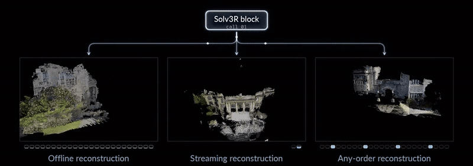

<h2 align="center">Solv3R: 3D Looped Transformer as a Multi-view Solver</h2>

<blockquote>
  

    <a href="https://jgkwak95.github.io/">Jeong-gi Kwak</a> · <a href="https://theialab.ca/">Andrea Tagliasacchi</a> · Sho Kagami · Yuki Ono · <a href="https://www.cs.ubc.ca/~kmyi/">Kwang Moo Yi</a> 
    University of British Columbia · Wayve Labs · Simon Fraser University 
    University of Toronto · Sony Semiconductor Solutions Corporation · Sony Corporation
  

</blockquote>

  
  
  

## News

- **[2026-11-02]** The [Solv3R paper][paper] is now available! Code and models will be released within a week.

[paper]: https://ubc-vision.github.io/solv3r/solv3r.pdf

## TODO

- [ ] Release pretrained models.
- [ ] Release evaluation code to reproduce the results reported in the paper.
